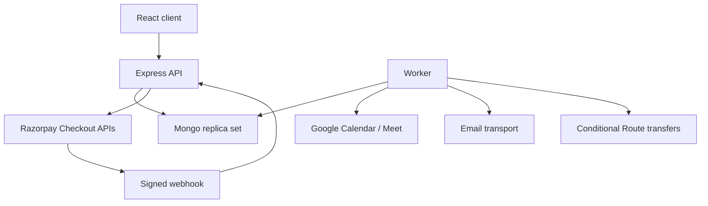

# Architecture and decisions

## Runtime

`apps/web` is a Vite React TypeScript SPA. `apps/api` is an Express TypeScript service; its separate worker process consumes Mongo-backed jobs. `packages/contracts` contains validation and deterministic policy/money logic. Npm workspaces share a lockfile, not application state. A reverse proxy serves the SPA and routes `/api` to Express on one HTTPS origin. MongoDB must be a replica set (Atlas or equivalent) for transactional booking/payment writes. Docker Compose supplies a local single-node replica set only; it is not a production HA configuration.

## Transaction boundaries

- Availability writes increment an expert schedule version inside the same transaction as overlap checks and slot inserts, serializing concurrent writes for that expert.
- Reserve: validate approved expert/active category/service, atomically claim slot, snapshot policy and price, insert booking. Idempotency keys are unique per customer and payload-bound; reuse for a different slot returns 409.
- Capture: validate external evidence before entering transaction, then insert event dedupe record, update booking/slot, write balanced ledger entry and enqueue side effects atomically. No provider network call occurs in a Mongo transaction.
- Cancel/reject/timeout: conditional state update and slot release together. Captured payment becomes refund_required. Late capture for cancelled/expired booking also becomes refund_required. An operator must resolve all such exceptions.
- Payout/refund: compare-and-set claimed operation before any provider call. Unknown network outcome is not automatically resent. Reconcile external state first. Provider-specific idempotency guarantees must be confirmed before live payouts/refunds.

## State machines

Booking: `held -> confirmed|pending_confirmation` after capture; `pending_confirmation -> confirmed|cancelled`; `held -> expired|cancelled`; `confirmed -> completed|cancelled`. No transition out of completed in this slice. Payment: `unpaid -> captured -> refund_required -> refunded`. Payouts: `eligible -> processing -> submitted -> paid`; `processing -> unknown|failed`. Transfer submission is not proof of bank settlement.

## Security

Opaque 256-bit session token in HttpOnly, SameSite=Lax cookie, Secure in production; only a SHA-256 digest stored. Strict allowed Origin plus application request header on unsafe JSON operations; login is protected too. Google credential posts require the same origin and a one-use nonce. No localStorage auth. Scrypt password hashes with per-password salt; no default admin password. Server-side role/ownership checks, Zod strict inputs, body-size limits, bounded queries, escape regex inputs, output allowlists, redacted errors, secure headers and auditable mutations.

Email codes use keyed digests, 10-minute expiry, attempt limits and atomic consumption. Phone verification uses a managed Verify service. API rate limits are a baseline single-instance control; shared rate limiting and distributed abuse tests are explicit deployment gates. Never print OTPs, access tokens, passwords, full payment payloads or personal meeting data in logs. Secrets come from runtime secret management and `.env` is ignored.

## Integration isolation

Provider adapters implement payments, Google identity, Calendar, email and SMS. Unit/integration tests inject deterministic fakes; fakes cannot be enabled by a production environment flag. Missing provider config returns an explicit unavailable status. Calendar refresh token remains server-side. Route requires both merchant eligibility and individual expert linked-account readiness. No LMS code or infrastructure dependencies exist.

## Live activation

Default payment mode is disabled. Test mode accepts only `rzp_test_` keys. Live mode requires `LIVE_TRANSACTIONS_ENABLED=true`, `BETA_ACCESS_MODE=invite`, and signed-off release evidence matching the exact deployed git commit: security, reconciliation and deployment checks all pass, with reviewer/time and evidence references. Admin settings cannot bypass the environment gate. Existing webhook reconciliation must continue even if checkout is disabled. Automatic payouts require a further Route gate. Evidence files are operator attestations; CI results and human sign-off must be reviewed, never auto-filled by application code.

## Reliability and monitoring

Jobs are durable with leases, exponential retries, capped attempts and a failed queue. A worker crash leaves a reclaimable lease. Stable Calendar event IDs prevent duplicate events. Email can be delivered more than once after an ambiguous SMTP timeout; transactional email provider idempotency is a follow-up. Booking writes create job records in the same transaction. Failed jobs surface to admins. Readiness reports DB/provider/release blockers; liveness reveals no secrets. Graceful shutdown closes HTTP and Mongo connections.

## Decisions to revisit after beta

Redis-backed limits/queues when scaling beyond one API instance; full-text index/Atlas Search when volume justifies it; object storage for verification evidence; provider webhook histories/settlement reconciliation; infrastructure as code, encrypted backups and observability. Do not substitute Cloudflare Worker storage for the explicitly requested Node/Mongo stack.

## Sources checked 20 October 2026

- Razorpay Checkout: https://razorpay.com/docs/payments/payment-gateway/web-integration/standard/integration-steps/
- Webhook raw-body validation and duplicate delivery: https://razorpay.com/docs/webhooks/validate-test/
- Route product/linked accounts: https://razorpay.com/docs/payments/route/
- Google ID token verification: https://developers.google.com/identity/gsi/web/guides/verify-google-id-token
- Calendar conference creation: https://developers.google.com/workspace/calendar/api/guides/create-events
- Mongo transaction deployment requirements: https://www.mongodb.com/docs/v8.0/core/transactions-production-consideration/

These documents inform adapter design. They do not establish account approval or end-to-end integration success.

## Homepage visual asset (20 October 2026)

`apps/web/public/images/mentoring-conversation.png` was generated using the built-in imagegen tool and copied into this repository. It is an illustrative marketing photo; the people pictured are not listed experts or customers. Expert cards use initials because the current public profile contract does not include portrait uploads. Homepage testimonials come only from the existing public verified-review API; no synthetic reviews or identities are seeded.

Final generation prompt:

> Generate a single photorealistic editorial website hero photograph, landscape 4:3. Two Indian young adult professionals having a friendly career mentoring conversation across a wooden table in a bright modern cafe office. Woman on left wearing a warm terracotta blouse, man on right wearing a dark navy shirt and glasses, laptop open on table, both relaxed and engaged, natural smiles and hand gestures. Waist-up medium shot, leafy plant in softly blurred warm cream background, soft daylight, candid high quality commercial lifestyle photography. Both faces visible and anatomically natural. Frame subjects centrally with some breathing room. No text, no logos, no UI, no graphic overlays, no watermarks. This is an illustrative marketing photo, not a portrait of a listed expert.
